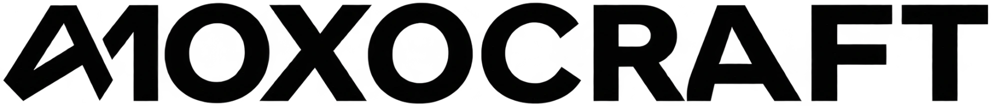
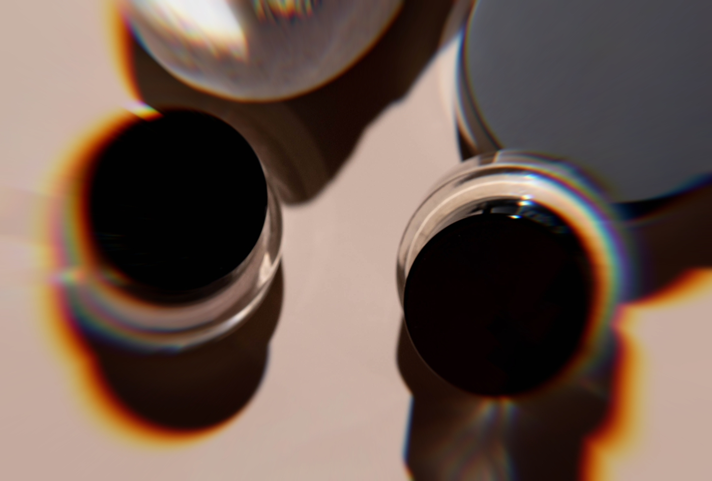
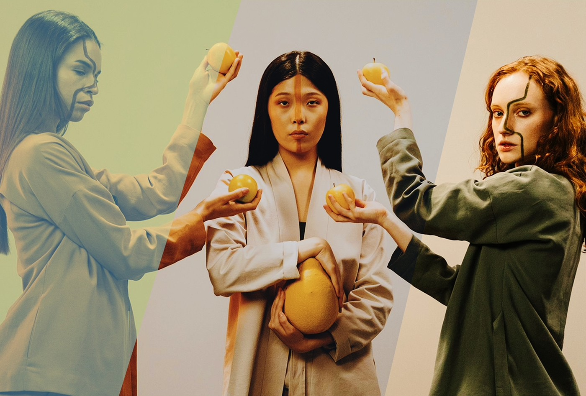
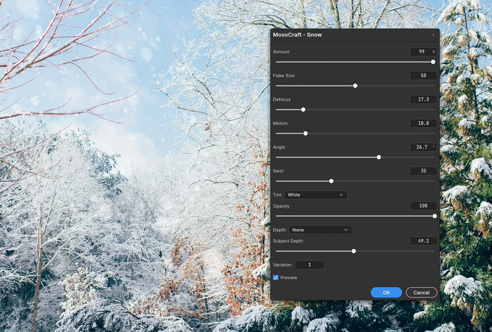

<p align="center">
  <picture>
    <source media="(prefers-color-scheme: dark)" srcset="docs/brand/moxocraft-logo-white.webp">
    
  </picture>
</p>

<p align="center">
  <b>Creative filters for PhotoCraft: lens fringes, film looks, falling snow and floating particles.</b><br>
  Six plug-ins for <a href="https://github.com/storytold/photocraft">PhotoCraft</a>, the free open-source photo editor.
</p>

<p align="center">
  
  
  
</p>

<p align="center">
  <a href="https://github.com/emilanderss0n/MoxoCraft/releases/latest"></a>
</p>

<p align="center">
  <a href="#features">Features</a> ·
  <a href="#install">Install</a> ·
  <a href="#moxocraft---chromatic-aberration">Chromatic Aberration</a> ·
  <a href="#lut-filters">LUTs</a> ·
  <a href="#moxocraft---snow">Snow</a> ·
  <a href="#moxocraft---floating-particles">Floating Particles</a> ·
  <a href="#credits">Credits</a>
</p>

<br>

<table>
  <tr>
    <td width="33%" valign="top">
      <h3>Live preview</h3>
      <p>Every filter previews on your image while you adjust it. Nothing changes until you press <b>OK</b>, and each run is a single undo step.</p>
    </td>
    <td width="33%" valign="top">
      <h3>Works on selections</h3>
      <p>Make a selection to filter only part of the image. Feathered selections blend smoothly, as with PhotoCraft's own filters.</p>
    </td>
    <td width="33%" valign="top">
      <h3>Any RGB image</h3>
      <p>8, 16 and 32 bits per channel, with or without transparency.</p>
    </td>
  </tr>
</table>

<br>

## Features

<table>
  <tr>
    <td width="50%" valign="top">
      
      <br>
      <sub>Soft rainbow fringes along glass and shadow edges.</sub>
      <h3>Lens fringes, subtle to bold</h3>
      <b>MoxoCraft - Chromatic Aberration</b> recreates the colored fringes real lenses leave along high-contrast edges. Spread them out from a center point like a real lens, or shift them the same way across the whole image for an RGB-split glitch.
      <br><br>
      <b>Five fringe types</b>: a smooth spectral rainbow, an RGB split, and red/cyan, green/magenta (purple fringing) and blue/yellow, from crisp copies to smooth gradients. The <a href="docs/chromatic-aberration.md">guide</a> has four recipes to start from.
    </td>
    <td width="50%" valign="top">
      
      <br>
      <sub>Colorful - Turquoise, Film - Kodak Portra 800 (Push 2) and Scenic - Tension Warm.</sub>
      <h3>147 ready-made looks</h3>
      Three LUT filters, each with an <b>Intensity</b> slider: <b>MoxoCraft - Film LUTs</b> for film stocks (color negative, slide and instant films, and Fujifilm-style camera looks), <b>MoxoCraft - Cinematic LUTs</b> for movie-style grades, moody and vintage looks, and black-and-white films, and <b>MoxoCraft - Creative LUTs</b> for colorful, scenic and experimental looks.
      <br><br>
      <b>59 film, 52 cinematic and 36 creative looks</b>, all listed under <a href="#all-147-looks">All 147 looks</a>.
    </td>
  </tr>
  <tr>
    <td colspan="2" valign="top">
      
      <br>
      <sub>MoxoCraft - Snow, previewing live in PhotoCraft.</sub>
      <h3>Snow with depth</h3>
      <b>MoxoCraft - Snow</b> draws snow the way it looks in a real photo: far flakes small, sharp and many; near flakes few, large and out of focus. Sharp flakes are irregular clumps, blurred ones soft discs, and falling flakes drift and tumble rather than drop like rain. Sizes follow the picture rather than pixels, so the same settings give the same look on any photo.
      <br><br>
      <b>Snow in front, snow behind</b>: split the snow at your subject's distance into a far layer and a near layer, then mask the far one behind your subject with <b>Select › Subject</b>. Or turn a depth map into snow that hides wherever the scene is nearer than each flake. Run Snow on an empty layer to keep it separate, where you can mask, move or fade it. <a href="#snow-behind-your-subject">How it works</a>.
    </td>
  </tr>
</table>

<br>

## All 147 looks

<table>
  <tr>
    <th align="left">Filter</th>
    <th align="left">Group</th>
    <th align="left">What's in it</th>
  </tr>
  <tr>
    <td rowspan="5" valign="top"><b>Film LUTs</b><br><sub>59 looks</sub></td>
    <td valign="top"><b>Film</b></td>
    <td>Kodak Portra 160, 400 and 800 (plus 800 pushed one and two stops), Gold 200, Ultramax 400 and Ektar 100 on Portra Endura paper; Fujifilm C200, Pro 400H and X-Tra 400 on Crystal Archive paper; and Kodak Vision3 50D, 250D, 200T and 500T on 2383 print film for the classic movie look. Simulated from measured film data.</td>
  </tr>
  <tr>
    <td valign="top"><b>Negative</b></td>
    <td>More color negative films, among them Agfa Vista, Fujifilm Superia and Pro 160C/800Z, Kodak Portra NC/VC/UC, a cross-processed Kodak Elite and Lomography Redscale.</td>
  </tr>
  <tr>
    <td valign="top"><b>Slide</b></td>
    <td>Fujifilm Velvia, Provia, Astia and Sensia, Kodak Kodachrome 64, Ektachrome and Elite Chrome, Agfa Precisa, Polaroid Polachrome and a Lomography cross-process slide film.</td>
  </tr>
  <tr>
    <td valign="top"><b>Instant</b></td>
    <td>Polaroid 665, 669, 690, PX-70, PX-680, PX-100UV+ and an expired Time Zero, and Fujifilm FP-100C and FP-3000B.</td>
  </tr>
  <tr>
    <td valign="top"><b>Fujifilm Style</b></td>
    <td>The look of Fujifilm cameras' Acros, Classic Chrome, Provia Standard and Velvia Vivid modes.</td>
  </tr>
  <tr>
    <td rowspan="4" valign="top"><b>Cinematic LUTs</b><br><sub>52 looks</sub></td>
    <td valign="top"><b>Cinematic</b></td>
    <td>Teal-and-orange and other blockbuster grades, plus warm, cool, neon and sunset looks.</td>
  </tr>
  <tr>
    <td valign="top"><b>Moody</b></td>
    <td>Dark, dramatic grades: icy, emerald, noir, night and horror looks.</td>
  </tr>
  <tr>
    <td valign="top"><b>Vintage</b></td>
    <td>Faded and retro film looks, and grades for the 1920s, 1930s, 1960s, 1970s and 1980s.</td>
  </tr>
  <tr>
    <td valign="top"><b>Black &amp; White</b></td>
    <td>Ilford HP5, FP4, Pan F and Delta 3200, Kodak Tri-X, T-Max and HIE infrared, Agfa APX, Fujifilm Neopan and Rollei Retro.</td>
  </tr>
  <tr>
    <td rowspan="3" valign="top"><b>Creative LUTs</b><br><sub>36 looks</sub></td>
    <td valign="top"><b>Colorful</b></td>
    <td>Bright and playful color grades.</td>
  </tr>
  <tr>
    <td valign="top"><b>Scenic</b></td>
    <td>Grades made for landscapes: greens, blues, fog and snow.</td>
  </tr>
  <tr>
    <td valign="top"><b>Creative</b></td>
    <td>Bold, experimental looks, including false-color infrared and Lomochrome Purple.</td>
  </tr>
</table>

<br>

## Install

1. Download `MoxoCraft-<version>.zip` from the latest
   [release](https://github.com/emilanderss0n/MoxoCraft/releases/latest) and unzip it somewhere
   you'll keep it. It holds the plug-in files (`moxocraft_chromatic_aberration.wasm`,
   `moxocraft_lut.wasm`, `moxocraft_lut_cinematic.wasm`, `moxocraft_lut_creative.wasm`,
   `moxocraft_snow.wasm` and `moxocraft_floating_particles.wasm`), a `luts` folder with the
   LUTs' licenses, credits and sources, and a `docs` folder with the Chromatic Aberration guide.
2. In PhotoCraft, either:
   - go to **Filter › Plug-ins › Install Plug-in…** and pick each `.wasm` file, or
   - go to **Edit › Preferences › Plug-ins**, turn on **Use Additional Plug-ins Folder** and point
     it at the unzipped folder. PhotoCraft then loads every MoxoCraft filter each time it starts;
     to update, unzip a newer release into the same folder.

The filters appear under **Filter › Plug-ins**. If you installed them from the menu, update by
installing the new `.wasm` files the same way; each replaces the old one. (Film LUTs replaces
the "MoxoCraft - LUT" filter from version 0.1.0.)

## Using the filters

Each filter opens a settings dialog with a live preview on your image. Nothing changes until you
press **OK**, and every run is a single undo step.

- Make a selection first to filter only part of the image; feathered selections blend smoothly,
  as with PhotoCraft's own filters.
- The filters work on RGB images at 8, 16 and 32 bits per channel, with or without transparency.
  Other color modes (Grayscale, CMYK, Lab) show an error instead.
- They work the same on Windows, macOS, Linux and PhotoCraft in the browser.

### From the command line

You can also run the filters from PhotoCraft's command line, for example on a batch of photos.
Run this from the unzipped MoxoCraft folder:

```bash
photocraft-cli run photo.jpg --cmd plugin.install --params '{"path":"moxocraft_lut.wasm"}' --cmd plugin.run --params '{"id":"moxocraft.lut","params":{"lut":"Film - Kodak Portra 400","intensity":80}}' --out photo-graded.jpg
```

## MoxoCraft - Chromatic Aberration

Real lenses bend red, green and blue light by slightly different amounts, which leaves colored
fringes along high-contrast edges. This filter recreates that, from barely there to bold.

> [!NOTE]
> The dialog always shows every setting, whichever **Mode** you pick. **Clear Center**,
> **Falloff** and **Center X / Y** only do anything in *Lens* mode, and **Angle** only in
> *Directional* mode.

| Setting | Mode | What it does |
|---|---|---|
| **Mode** | Both | *Lens*: colors spread outward from a center point, strongest toward the corners, like a real lens. *Directional*: colors shift the same way across the whole image. |
| **Fringe** | Both | Which colors separate. *Spectral* gives a smooth rainbow, *RGB Split* sends red and blue opposite ways, and *Red/Cyan*, *Green/Magenta* (purple fringing) and *Blue/Yellow* give two-color fringes. |
| **Amount** | Both | How far the colors move, in pixels (at the corners, in Lens mode). Negative values swap which color lands on which side. |
| **Softness** | Both | 0 gives crisp separate copies of each color; higher values blend them into smooth gradients. |
| **Strength** | Both | How strongly the effect shows over your original, from 0 (unchanged) to 100 (the full effect). It fades the fringes without moving them. |
| **Clear Center** | Lens | How much of the middle stays untouched. |
| **Falloff** | Lens | How quickly the effect builds toward the edges. 1 is even; higher keeps it near the corners, lower spreads it inward. |
| **Center X / Y** | Lens | Where the lens center sits, as a percentage of the image width and height. |
| **Angle** | Directional | The direction of the shift in degrees, counter-clockwise from pointing right. |

Tips:

- For a natural lens look, keep **Mode** on *Lens* with a small **Amount** (try 3–10 px on a
  24-megapixel photo).
- If the fringes are the right shape but too strong, lower **Strength** rather than **Amount**.
  Amount changes how far the colors move, so lowering it narrows the fringes as well as fading
  them. Strength only fades them.
- For a glitch look, use *Directional*, *RGB Split* and **Softness** 0.

The [Chromatic Aberration guide](docs/chromatic-aberration.md) has four recipes with
before-and-after pictures (Subtle Lens, Purple Fringing, Dreamy Spectral and RGB Glitch), and
more on how Strength blends and how far the colors can move.

## LUT filters

Each LUT filter gives your photo a ready-made look. Pick one from the **LUT** list, which is
grouped by category ("Film - Kodak Portra 400", "Slide - Fujifilm Velvia 50", ...), and set how
strongly it applies. Every look is listed under [All 147 looks](#all-147-looks).

| Setting | What it does |
|---|---|
| **LUT** | Which look to apply. |
| **Intensity** | How strongly it applies, from 0 (your original) to 100 (the full look). |

Tips:

- The Film category keeps your photo's overall brightness and changes color and contrast; whites
  settle at the slightly creamy white of a real photographic print. Many of the other looks are
  bolder. If one is too strong, lower **Intensity**.
- For more control, apply it to a duplicate layer and lower that layer's opacity or paint a
  mask.

## MoxoCraft - Snow

Falling snow with depth, the way it looks in a real photo: flakes far behind your subject are
small and many, flakes close to the camera few, large and out of focus. In-focus flakes are
irregular clumps, out-of-focus ones soft discs like a lens draws them, and falling flakes drift
and tumble rather than drop straight like rain. Sizes are measured against the picture rather
than in pixels, so the same settings give the same look on any photo, and the live preview
matches the result.

Run it on an empty layer (**Layer › New › Layer…**) to keep the snow on a layer of its own, where
you can mask, move or fade it. The result looks the same as running it on the photo.

| Setting | What it does |
|---|---|
| **Amount** | How much snow. Raising it adds flakes without moving the ones already there. |
| **Flake Size** | How big the flakes at your subject's distance are. Every 25 doubles their size. |
| **Defocus** | How blurry flakes get away from your subject, like a lens opened wide. Flakes in front of the subject blur the most; 0 keeps every flake sharp. |
| **Motion** | 0 freezes the flakes. Higher values streak them, as if they fell while the shutter was open; near flakes streak the most, and each streak flickers a little as its flake tumbles. |
| **Angle** | Which way the snow falls, in degrees from straight down; positive values lean it to the right. Only does anything when Motion is above 0. |
| **Swirl** | How much falling flakes wander from that direction and curve: 0 for heavy, wet snow falling straight, 100 for light snow swirling in the wind. Only does anything when Motion is above 0. |
| **Tint** | The flakes' color: *White*, *Cool* (blue, as in shade or at dusk) or *Warm* (lit by streetlights or a low sun). |
| **Opacity** | How strongly the snow shows, from 0 to 100. The same as lowering the opacity of a layer holding the snow. |
| **Depth** | *None* draws all the snow. *Near Only* and *Far Only* draw only the flakes in front of or behind Subject Depth. *Depth Map* and *Depth Map (Inverted)* turn a depth map into snow. Both are explained below. |
| **Subject Depth** | How far away your subject is, from 0 (at the lens) to 100 (as far as the snow goes). Flakes at that distance are the sharpest, and Near Only and Far Only split the snow there. |
| **Variation** | Picks a different random layout. The other settings don't move the flakes, so you can get the look right first and then try layouts. |

### Snow behind your subject

A plug-in can't tell what's near or far in a photo, so on its own Snow puts every flake in front
of everything. There are two ways to put some of it behind your subject.

**Near and far layers.** This needs nothing outside PhotoCraft.

1. Set **Subject Depth** to roughly where your subject stands.
2. Add an empty layer and run Snow with **Depth** set to *Far Only*.
3. Select your subject (**Select › Subject**, or any selection tool), choose **Select › Inverse**,
   then **Layer › Layer Mask › Reveal Selection**. The far snow now goes behind your subject.
4. Add another empty layer on top and run Snow again with the same settings and **Depth** set to
   *Near Only*.

Together, the two layers hold the same snow as *None*.

**A depth map.** This handles any scene, but you need a depth map: a grayscale picture of how far
away each part of your photo is. Depth-estimation tools such as Depth Anything make one from a
photo.

1. Put the depth map on a layer of its own, lined up with your photo and the same size.
2. Run Snow on that layer with **Depth** set to *Depth Map*. The layer turns into snow, each flake
   hidden wherever the scene is nearer than the flake.

*Depth Map* expects white for near and black for far, as most tools make them; use
*Depth Map (Inverted)* for a map the other way round. Duplicate the depth map first if you want
to use it again.

Tips:

- Snow shows best against darker backgrounds, as it does in real photos.
- For light snow, try **Amount** 20–30 and **Defocus** 20. For a blizzard, try **Amount** 80–100,
  **Motion** 40–60, **Angle** 30–60 and **Swirl** 60–80.
- For a dreamy look, raise **Defocus** to 70–90 and **Flake Size** to 60–70: near flakes turn into
  large, soft discs.
- **Motion** streaks look best in small amounts (10–40). Real falling snow rarely streaks far.
- Sharp flakes show their clumpy shapes best at full size. Zoomed out, every flake looks round.
- With very large, blurred and streaked flakes at a high **Amount**, Snow limits how many flakes
  it draws so it finishes in time. Past that point, raising **Amount** adds nothing more.

## MoxoCraft - Floating Particles

Dust, pollen or specks of light floating in the air, with depth: particles far behind your
subject are small and many, particles close to the camera few, large and out of focus. Sharp
particles are soft points, and blurred ones are round discs with a faint bright rim, as a lens
draws them. As with Snow, sizes are measured against the picture rather than in pixels, so the
same settings give the same look on any photo, and the live preview matches the result.

Run it on an empty layer (**Layer › New › Layer…**) to keep the particles on a layer of their
own, where you can mask, move or fade them. The result looks the same as running it on the
photo.

PhotoCraft's filter dialogs have no color picker, so you set the particles' color with the
**Hue**, **Saturation** and **Brightness** sliders. The default is the warm white of dust in
sunlight.

| Setting | What it does |
|---|---|
| **Amount** | How many particles. Raising it adds particles without moving the ones already there. |
| **Particle Size** | How big the particles at your subject's distance are. Every 25 doubles their size. |
| **Size Variety** | How much the particles' sizes differ: 0 makes them all the same size, 100 mixes many tiny specks with a few large ones. |
| **Defocus** | How blurry particles get away from your subject, like a lens opened wide. Particles in front of the subject blur the most; 0 keeps every particle sharp. |
| **Glow** | A soft halo around sharp particles, the way bright points bloom in a real photo. Blurred particles get none. |
| **Clustering** | 0 spreads the particles evenly. Higher values gather them into loose clouds with gaps between, as dust shows only where light catches it. There are about as many particles either way. |
| **Hue** | The particles' color, in degrees around the color wheel: 0 red, 60 yellow, 120 green, 180 cyan, 240 blue, 300 magenta. |
| **Saturation** | How strong the color is, from 0 (white or gray) to 100 (the pure hue). |
| **Brightness** | How light the particles are, from 0 (black) to 100. Keep it high for particles of light; lower it for dark dust or soot. |
| **Opacity** | How strongly the particles show, from 0 to 100. The same as lowering the opacity of a layer holding them. |
| **Depth** | The same choices as Snow's. *Near Only* and *Far Only*, or a depth map, put particles behind your subject, exactly as [Snow behind your subject](#snow-behind-your-subject) describes. |
| **Subject Depth** | How far away your subject is, from 0 (at the lens) to 100 (as far as the particles go). Particles at that distance are the sharpest, and Near Only and Far Only split them there. |
| **Variation** | Picks a different random layout. The other settings don't move the particles, so you can get the look right first and then try layouts. |

Tips:

- Particles show best against darker backgrounds, like dust in a sunbeam against shade.
- For dust in sunlight, try **Amount** 50–70, **Particle Size** 30–40 and **Clustering** 60–80.
- For dreamy bokeh, raise **Defocus** to 80–100 and **Particle Size** to 60–70, and lower
  **Subject Depth** to 10–20: near particles turn into large, soft discs.
- For a magical sparkle, try **Glow** 70–100 with a gold (**Hue** 40–50, **Saturation** 60–70)
  or any color you like. **Saturation** 0 gives white particles.
- With very large, sharp, glowing particles at a high **Amount**, the filter limits how many
  particles it draws so it finishes in time. Past that point, raising **Amount** adds nothing
  more.

## Speed

PhotoCraft runs plug-ins in a sandbox that keeps them safe but makes them slower than its
built-in filters, and it stops any plug-in run that takes longer than 60 seconds. Times measured
on a 24-megapixel photo with a Ryzen 7 7800X3D, using all 16 threads and with PhotoCraft limited
to 4 cores running one thread each:

| Filter and settings | 16 threads | 4 cores |
|---|---|---|
| Snow, default settings | under 0.1 s | 0.2 s |
| Snow, heavy (Amount 100, Flake Size 60, Defocus 50, Motion 40) | 1 s | 4 s |
| Snow, every setting at its largest | 5 s | 22 s |
| Floating Particles, default settings | under 0.1 s | 0.2 s |
| Floating Particles, heavy (Amount 100, Particle Size 70, Defocus 60, Glow 60) | 0.3 s | 1 s |
| Floating Particles, heaviest settings (Amount, Particle Size, Size Variety and Glow 100, Defocus 0, Subject Depth 100) | 4 s | 14 s |
| Chromatic Aberration, default settings | 9 s | 41 s |
| Chromatic Aberration, heaviest settings (*Spectral*, Amount 128, Softness 100, Clear Center 0, Falloff 0.5) | 12–15 s | 48–55 s |

With a depth map, Floating Particles' heaviest settings took 4.5 seconds on 16 threads and 19 on 4
cores. With 4 cores running two threads each, Chromatic Aberration's heaviest settings took 19–22
seconds. **Strength** between 0 and 100 adds about 20% at light settings, but only 1–2 seconds at
the heaviest. The LUT filters take about 1–4 seconds.

> [!IMPORTANT]
> Chromatic Aberration's smooth fringes are the slow part. On a computer slower than this one with
> only 4 threads, they can go past the 60-second limit; PhotoCraft then stops the filter and leaves
> the image as it was. Crisp fringes (**Softness** 0) are much quicker: the RGB Glitch recipe took 2
> seconds on 16 threads and 10 on 4 cores.

## Credits

The LUTs come from these collections, each under a license that allows sharing them. MoxoCraft
converted them to the same format and size and renamed them; [`luts/SOURCES.txt`](luts/SOURCES.txt)
lists every LUT with its author, source and license.

- **Film**: derived from [spektrafilm](https://github.com/andreavolpato/spektrafilm) by Andrea
  Volpato, which simulates film from measured film data. Licensed
  [CC BY-SA 4.0](luts/SPEKTRAFILM_LICENSE.txt); how they were made is in
  [`luts/CHANGELOG.txt`](luts/CHANGELOG.txt).
- **Negative, Slide, Instant and Black & White**: Pat David's
  [film emulation presets](https://patdavid.net/2013/08/film-emulation-presets-in-gmic-gimp/), from
  the [NatronGitHub/clut](https://github.com/NatronGitHub/clut) collection. Licensed
  [CC BY-SA 4.0](luts/CC-BY-SA-4.0.txt).
- **Fujifilm Style**: [FilmSim](https://github.com/sguyader/FilmSim) by Sébastien Guyader, public
  domain (CC0). Community-made, not by Fujifilm.
- **Cinematic, Moody, Vintage and Colorful**: LUTs shared on [freshLUTs](https://freshluts.com)
  by their creators (CC0), as selected by [OpenShot](https://github.com/OpenShot/openshot-qt);
  [slay](https://www.slaycamera.com/) (Amber, Fade, Film, Neon and Portrait;
  [CC BY 4.0](luts/CC-BY-4.0.txt)); and Striped Purple.
- **Striped Purple** (in Vintage, Colorful, Scenic and Creative): by Austin Barrett,
  [color-grading-luts](https://github.com/stripedpurple/color-grading-luts), under the
  [MIT license](luts/STRIPED_PURPLE_LICENSE.txt).
- **Scenic**: also Tension Warm, Tension Cold and Krakow by
  [Christoph Wurst](https://github.com/ChristophWurst/haldclut) ([CC BY-SA 4.0](luts/CC-BY-SA-4.0.txt)).

> [!IMPORTANT]
> The licenses cover the LUTs themselves, not the photos you make with them. If you share the
> MoxoCraft plug-ins, keep the `luts` folder (licenses, sources and changelog) with them.

The example photos are by [Ian Schneider](https://unsplash.com/@goian) on Unsplash
([snowy forest](https://unsplash.com/photos/green-pine-trees-during-snow-season-dqMxDqdhg_4)) and
[Ron Lach](https://www.pexels.com/@ron-lach/) on Pexels
([glass jars](https://www.pexels.com/photo/makeup-products-beside-a-rock-8128070/) and
[three women with fruit](https://www.pexels.com/photo/women-in-suits-posing-with-fruits-9463583/)).

<sub>Kodak, Fujifilm, Ilford, Agfa, Polaroid, Lomography, Rollei and the film names are trademarks
of their owners. They are used only to describe the looks simulated; their owners don't endorse
MoxoCraft.</sub>

## Development

MoxoCraft is written in Rust. Install [Rust](https://rustup.rs), then build the plug-ins into
`dist/` and run the tests:

```powershell
./build.ps1
cargo test
```

[`docs/development.md`](https://github.com/emilanderss0n/MoxoCraft/blob/main/docs/development.md)
covers how the code is organized, previews, benchmarks, adding a filter and releasing.
[`docs/luts.md`](https://github.com/emilanderss0n/MoxoCraft/blob/main/docs/luts.md) covers the LUT
files: adding and removing LUTs, re-making them from their sources, and their licenses.

<br>

<p align="center">
  <br>
  <sub>Made by <a href="https://moxopixel.com/">MoxoPixel</a> for <a href="https://github.com/storytold/photocraft">PhotoCraft</a>.</sub>
</p>
