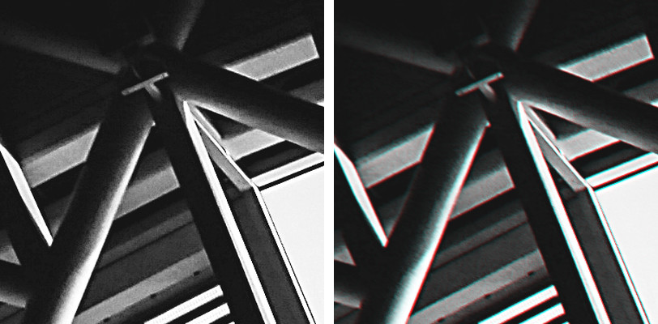
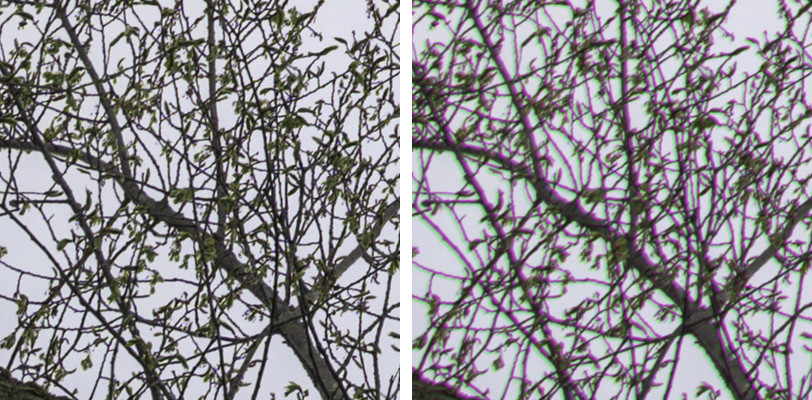
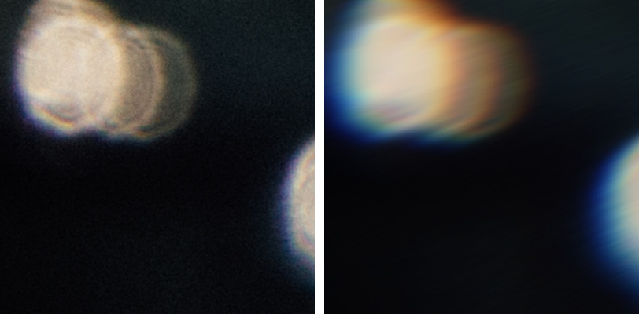
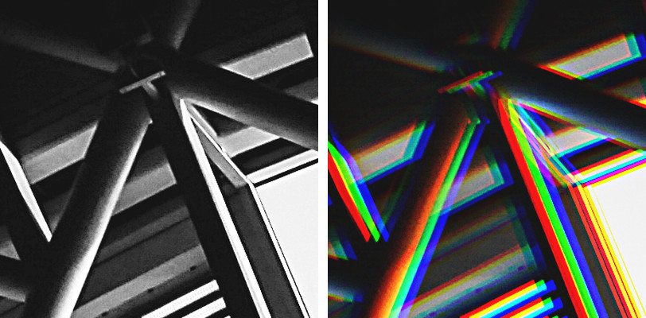

# Chromatic Aberration guide

Recipes and tips for **MoxoCraft - Chromatic Aberration**. The settings are described in the
[README](../README.md#moxocraft---chromatic-aberration).

## Recipes

Four starting points. Settings not listed stay at their defaults. The amounts are for a photo
about 6000 px wide (24 megapixels). Amount is measured in pixels, so for other sizes scale it with
the width: half as much on a photo 3000 px wide, for example. Each picture is a 400 px crop near a
corner at 100%, before on the left and after on the right.

### Subtle Lens

*Lens*, *Red/Cyan*, **Amount** 4, **Softness** 30, **Clear Center** 10, **Falloff** 1.

Thin red and cyan edges like a real lens leaves toward the corners, without softening much
detail. Best on sharp, high-contrast subjects: architecture, window frames, branches. At
fit-to-screen size you'll hardly see it, which is the point.

### Purple Fringing

*Lens*, *Green/Magenta*, **Amount** -4, **Softness** 50, **Clear Center** 10, **Falloff** 1,
**Strength** 60.

The purple outline cheaper lenses leave on dark edges against a bright sky. Best on backlit
scenes: branches, wires, window frames or silhouettes against the sky. Green/Magenta also leaves
a green edge on the other side of each line. Strength 60 fades that green more than the purple:
on the example photo, the purple came out about 30% stronger than the green, where at Strength
100 they are about even.

### Dreamy Spectral

*Lens*, *Spectral*, **Amount** 30, **Softness** 80, **Clear Center** 30, **Falloff** 1.2.

Soft rainbow glows that grow toward the edges while the middle stays sharp. Best on soft,
backlit or night photos with bright highlights: sun on water, out-of-focus lights, a portrait
with the subject in the middle. It smears fine detail near the edges, so it doesn't suit sharp
architecture.

### RGB Glitch

*Directional*, *RGB Split*, **Amount** 12, **Softness** 0.

Hard red, green and blue copies shifted sideways across the whole picture. Best on bold, graphic
images: architecture, neon and night scenes, posters. Raise **Amount** to 20–30 for a bigger
split, or change **Angle** to shift the copies another way.

The example photos are public domain (CC0), from Wikimedia Commons:
[steel roof](https://commons.wikimedia.org/wiki/File:King_cross_roof_architecture_%28Unsplash%29.jpg),
[bare branches](https://commons.wikimedia.org/wiki/File:Bare_branches_against_a_white_sky,_Quebec_City.jpg)
and [surfer and sea](https://commons.wikimedia.org/wiki/File:Surfer_and_sea_reflecting_the_sun_%28Unsplash%29.jpg).
They were resized to 6000 px wide before applying the filter.

## Tips

- The effect shows most on bright edges against dark backgrounds. The colors are mixed as light,
  so fringes around highlights glow rather than turning muddy.
- **Strength** isn't quite the same as putting the effect on a duplicate layer and lowering its
  opacity. It blends light the way a lens does, rather than the values you see on screen. At 50%,
  bright fringes against a dark background stay a little stronger, and dark fringes against a
  bright sky fade a little more, than they would on a layer at 50% opacity.
- The largest possible shift is about 65–125 px, depending on Softness: a plug-in can only read
  a limited margin of pixels around each part of the image, and larger amounts are capped to it.
